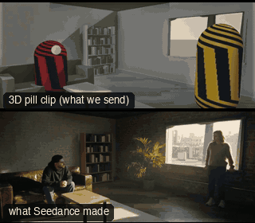

# SC02-InteriorDialogue: Interior dialogue



Family: Scenes.

**What it says.** Two people talk; the camera tells us whose moment it is.

**Use it for.** Any two-person scene: a confession, an argument, an interview.

**Camera numbers.** Master 28 mm, OTS pair 75 mm matched, close-up 65 mm, every camera on one side of the line between them.

**Avoid.** Crossing the line, or cutting in to the close-up before the turn of the scene.

## The three.js code

This is an excerpt of the template (14 lines, from `engine/cinematic/src/templates/scenes.ts`). `template.ts` in this folder is the same code with its imports. The helpers it calls (`make`, the actors, the rigs, the set and the post chain) are in `engine/cinematic/src`, so it does not run on its own: render it with `tools/render-pill.sh`.

```ts
import * as THREE from "three";
import { planner, scenePiece, type KitWorld, type SceneSpec, type ShotDef } from "../kit/stage";
import type { ActorSpec } from "../kit/actors";
import { GREY, clay } from "../kit/clay";
import { lag, rig } from "../kit/rigs";
import { aimFor } from "../framer";
import { asteroid, bench, broadTree, building, bush, car, carInterior, floorLamp, ground, lampPost, pine, planet, rock, room, scatter, shelf, sofa, table } from "../kit/props";
import { rng } from "../util";
import type { Piece } from "../piece";
import type { TemplateInfo } from "./cameras";

make({ id: "SC02-InteriorDialogue", name: "Interior dialogue", pattern: "Master two-shot → OTS → reverse OTS → close-up at the turn → master from a new angle", says: "Two people talk; the camera tells us whose moment it is.", use: "Any two-person scene: a confession, an argument, an interview.", numbers: "Master 28 mm, OTS pair 75 mm matched, close-up 65 mm, every camera on one side of the line between them.", avoid: "Crossing the line, or cutting in to the close-up before the turn of the scene." },
    { sky: "interior", build: buildRoom, keyDir: [0.25, 0.6, -0.76], motes: { center: [0, 1.4, 0], size: [6, 2.6, 5], count: 140, drift: [0.03, 0.01, 0.02] },
      actors: [human("ALEX", "Alex", "ochre", [{ t: 0, at: [-1.45, 0.9], yaw: Math.PI / 2 }], { acts: [{ kind: "sit", t0: -1 }, { kind: "talk", t0: 7, t1: 14.5 }], look: "SAM" }),
        human("SAM", "Sam", "slate", [{ t: 0, at: [1.6, -1.2], yaw: -2.2 }], { look: "ALEX", acts: [{ kind: "talk", t0: 0, t1: 7.5 }] })] },
    (P) => {
      const mid = V(0.1, 1.15, -0.15), M1 = V(2.85, 1.55, 2.4), M2 = V(-2.3, 1.45, 2.3);
      return [
        { start: 0, end: 4, label: "24mm  MASTER TWO-SHOT", rig: "TRIPOD", subject: "SAM", size: "MWS", stop: 4, pair: ["ALEX", "SAM"], cam: () => ({ pos: M1.clone(), target: aimFor(M1, mid, 24, [0, 0]), mm: 24 }), cut: "Opens on the master", flags: ["centre"] },
        { start: 4, end: 7.5, label: "75mm  OTS · ALEX ON SAM", rig: "STEADICAM", subject: "SAM", size: "MS", stop: 2, ots: "ALEX", pair: ["ALEX", "SAM"], cam: rig.ots(P("ALEX"), P("SAM"), 75, 1, 2.4, 0.72), cut: "CUT in over her shoulder" },
        { start: 7.5, end: 11, label: "75mm  REVERSE OTS · SAM ON ALEX", rig: "STEADICAM", subject: "ALEX", size: "MS", stop: 2, ots: "SAM", pair: ["ALEX", "SAM"], reverse: 2, cam: rig.ots(P("SAM"), P("ALEX"), 75, -1, 2.4, 0.72), cut: "CUT to the reverse, same side of the line" },
        { start: 11, end: 14, label: "65mm  CLOSE-UP · THE TURN", rig: "DOLLY", subject: "ALEX", size: "MCU", sizeEnd: "CU", stop: 2, pair: ["ALEX", "SAM"], cam: rig.dolly(P("ALEX"), { size: "MCU", mm: 65, deg: -10 }, "CU", 11, 14, 0.4), cut: "CUT in tighter: the turn of the scene" },
        { start: 14, end: 17.5, label: "28mm  MASTER · NEW ANGLE", rig: "TRIPOD", subject: "SAM", size: "WS", stop: 4, pair: ["ALEX", "SAM"], cam: () => ({ pos: M2.clone(), target: aimFor(M2, mid, 28, [0, 0]), mm: 28 }), cut: "CUT back out to the master, 30°+ from the first", flags: ["centre"] },
      ];
    }),
```

**Make it yours.** Change rig: `rig.dolly`, `rig.ots`; lens: 24 mm, 28 mm, 65 mm; shot size: MCU, MS, MWS, WS. The actor `path` entries say where the pill stands and walks, and the numbers after `rig.` set the move (distance, angle, rise, start and end time).

## The videos

The stand-in in `pill.mp4` is the **capsule** (the single striped capsule of the first gallery clips). Render the other with `--standin pin`.

| What | File |
|---|---|
| The 3D pill clip, the reference video (a re-render: the clip that was uploaded was not kept) | `pill.mp4` |
| What Seedance made from the pill clip (480p draft) | `release-media/SC02-InteriorDialogue/result.mp4` (release asset) |

## The prompt

One file per send. `sent.json` says, for each, whether it is the text that was sent, a recovered copy, or a rebuilt copy (`prompt.provenance`):

- `prompts/video-1.txt`
- `prompts/video-2.txt`

Keep the lines that say what the pills are and that the set is to be rebuilt as real. Change the person, the place and the light. These prompts come from the gallery runs and many predate the checks in `tools/seedance/`, so rebuild one with the gates before you reuse it.

## How it was sent

`sent.json` holds, for each send: the references in order with their roles, the settings, the credits and the outcome. Request ids are not kept; where one was known, a short hash is stored.

- **video #1**: 18 s, draft (480p preview), 21:9; references: @video1 = pill clip (the 3D blockout), @image1 = person photo (face reference); confirmed: no receipt.
- **video #2**: 18 s, draft (480p preview), 21:9; references: @video1 = pill clip (the 3D blockout), @image1 = person photo (face reference); confirmed: yes; 2624.4 credits.

See `reproduce.md` to render it and send it yourself.
