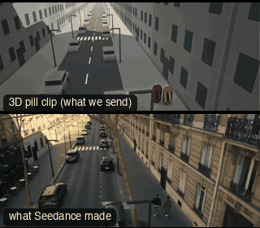

# SC03-StreetWalkTalk: Street walk-and-talk



Family: Scenes.

**What it says.** Two people on the move, talking; the city carries on around them.

**Use it for.** Walk-and-talks, chases on foot, arrivals in a city.

**Camera numbers.** Establishing 24 mm from 8 m up over the road, lead 32 mm, long-lens tracking 85 mm from across the road (over the parked cars), low wide 20 mm.

**Avoid.** Losing screen direction: they keep walking the same way in every shot.

## The three.js code

This is an excerpt of the template (10 lines, from `engine/cinematic/src/templates/scenes.ts`). `template.ts` in this folder is the same code with its imports. The helpers it calls (`make`, the actors, the rigs, the set and the post chain) are in `engine/cinematic/src`, so it does not run on its own: render it with `tools/render-pill.sh`.

```ts
import * as THREE from "three";
import { planner, scenePiece, type KitWorld, type SceneSpec, type ShotDef } from "../kit/stage";
import type { ActorSpec } from "../kit/actors";
import { GREY, clay } from "../kit/clay";
import { lag, rig } from "../kit/rigs";
import { aimFor } from "../framer";
import { asteroid, bench, broadTree, building, bush, car, carInterior, floorLamp, ground, lampPost, pine, planet, rock, room, scatter, shelf, sofa, table } from "../kit/props";
import { rng } from "../util";
import type { Piece } from "../piece";
import type { TemplateInfo } from "./cameras";

make({ id: "SC03-StreetWalkTalk", name: "Street walk-and-talk", pattern: "High establishing → Steadicam lead two-shot → tracking single → low-angle wide", says: "Two people on the move, talking; the city carries on around them.", use: "Walk-and-talks, chases on foot, arrivals in a city.", numbers: "Establishing 24 mm from 8 m up over the road, lead 32 mm, long-lens tracking 85 mm from across the road (over the parked cars), low wide 20 mm.", avoid: "Losing screen direction: they keep walking the same way in every shot." },
    { sky: "day", build: buildStreet, keyDir: [0.55, 0.7, 0.45], motes: { center: [5, 2, 4], size: [24, 5, 40], count: 200 },
      actors: [human("ALEX", "Alex", "ochre", [{ t: 0.2, at: [6.7, 14] }, { t: 14.6, at: [6.7, -6.5] }], { look: "SAM", lookFrom: 4, lookTo: 7 }),
        human("SAM", "Sam", "slate", [{ t: 0.2, at: [7.55, 14.4] }, { t: 14.6, at: [7.55, -6.1] }], { look: "ALEX", lookFrom: 8, lookTo: 11 })] },
    (P) => [
      { start: 0, end: 4, label: "24mm  HIGH ESTABLISHING", rig: "TECHNOCRANE", subject: "ALEX", size: "WS", stop: 5.6, cam: () => { const pos = V(2.2, 9.5, 27); return { pos, target: V(5.8, 1, 4), mm: 24 }; }, cut: "Opens high on the street", flags: ["centre"] },
      { start: 4, end: 8, label: "32mm  STEADICAM LEAD · TWO-SHOT", rig: "STEADICAM", subject: "ALEX", size: "FS", stop: 2.8, cam: rig.follow(P("ALEX"), { size: "FS", mm: 32, deg: 18, rise: 0.05 }), cut: "CUT to the front: they walk at us", flags: ["enters-moving", "exits-moving", "short-side"] },
      { start: 8, end: 11, label: "85mm  LONG-LENS TRACKING", rig: "CAMERA CAR · ACROSS THE ROAD", subject: "ALEX", size: "MS", stop: 2.8, cam: rig.track(P("ALEX"), { size: "MS", mm: 85, rise: 0.55 }, 1, 0.6), cut: "CUT to the side: same direction of travel", flags: ["enters-moving", "exits-moving"] },
      { start: 11, end: 14.5, label: "20mm  LOW-ANGLE WIDE", rig: "TRIPOD · LOW HAT", subject: "ALEX", size: "WS", stop: 4, cam: rig.locked(P("ALEX"), { size: "FS", mm: 20, deg: -25, rise: -0.62 }, 13.8), cut: "CUT low ahead of them: they walk into the frame", flags: ["centre"] },
    ]),
```

**Make it yours.** Change rig: `rig.follow`, `rig.locked`, `rig.track`; lens: 20 mm, 24 mm, 32 mm, 85 mm; shot size: FS, MS, WS. The actor `path` entries say where the pill stands and walks, and the numbers after `rig.` set the move (distance, angle, rise, start and end time).

## The videos

The stand-in in `pill.mp4` is the **capsule** (the single striped capsule of the first gallery clips). Render the other with `--standin pin`.

| What | File |
|---|---|
| The 3D pill clip, the reference video (a re-render: the clip that was uploaded was not kept) | `pill.mp4` |
| The contact sheet (sketch route) | `sketch-sheet.jpg` |
| What Seedance made from the pill clip (480p draft) | `release-media/SC03-StreetWalkTalk/result.mp4` (release asset) |
| What Seedance made from the contact sheet | `release-media/SC03-StreetWalkTalk/sketch-output.mp4` (release asset) |
| Another take from the same template | `release-media/SC03-StreetWalkTalk/ink-sketch-ink-sc03.mp4` |

## The prompt

One file per send. `sent.json` says, for each, whether it is the text that was sent, a recovered copy, or a rebuilt copy (`prompt.provenance`):

- `prompts/ink-sketch-recovered-sheet.txt`
- `prompts/video-1.txt`
- `prompts/video-2.txt`
- `prompts/video-3.txt`

Keep the lines that say what the pills are and that the set is to be rebuilt as real. Change the person, the place and the light. These prompts come from the gallery runs and many predate the checks in `tools/seedance/`, so rebuild one with the gates before you reuse it.

## How it was sent

`sent.json` holds, for each send: the references in order with their roles, the settings, the credits and the outcome. Request ids are not kept; where one was known, a short hash is stored.

- **video #1**: 15 s, draft (480p preview), 21:9; references: @video1 = pill clip (the 3D blockout), @image1 = person photo (face reference); confirmed: no receipt.
- **video #2**: 15 s, draft (480p preview), 21:9; references: @video1 = pill clip (the 3D blockout), @image1 = person photo (face reference); confirmed: yes.
- **video #3**: 15 s, draft (480p preview), 21:9; references: @video1 = pill clip (the 3D blockout), @image1 = person photo (face reference); confirmed: yes; 2114.1 credits.
- **ink-sketch #1**: 15 s, draft (480p preview), 21:9; references: @image1 = person photo (face reference), @image2 = pill contact sheet (the sketch route); confirmed: yes; 1833 credits.

See `reproduce.md` to render it and send it yourself.
