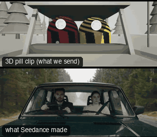

# SC04-CarInterior: Car interior



Family: Scenes.

**What it says.** Two people trapped together in motion: intimacy, tension, a confession.

**Use it for.** Dialogue in a moving vehicle; road trips; an escape.

**Camera numbers.** Windshield two-shot 28 mm, singles 32 mm from the windshield corners (both in front: one side of the line), POV 24 mm.

**Avoid.** A static world outside: the road must move or the car reads as parked.

## The three.js code

This is an excerpt of the template (15 lines, from `engine/cinematic/src/templates/scenes.ts`). `template.ts` in this folder is the same code with its imports. The helpers it calls (`make`, the actors, the rigs, the set and the post chain) are in `engine/cinematic/src`, so it does not run on its own: render it with `tools/render-pill.sh`.

```ts
import * as THREE from "three";
import { planner, scenePiece, type KitWorld, type SceneSpec, type ShotDef } from "../kit/stage";
import type { ActorSpec } from "../kit/actors";
import { GREY, clay } from "../kit/clay";
import { lag, rig } from "../kit/rigs";
import { aimFor } from "../framer";
import { asteroid, bench, broadTree, building, bush, car, carInterior, floorLamp, ground, lampPost, pine, planet, rock, room, scatter, shelf, sofa, table } from "../kit/props";
import { rng } from "../util";
import type { Piece } from "../piece";
import type { TemplateInfo } from "./cameras";

make({ id: "SC04-CarInterior", name: "Car interior", pattern: "Windshield two-shot → driver single → passenger single → POV of the road", says: "Two people trapped together in motion: intimacy, tension, a confession.", use: "Dialogue in a moving vehicle; road trips; an escape.", numbers: "Windshield two-shot 28 mm, singles 32 mm from the windshield corners (both in front: one side of the line), POV 24 mm.", avoid: "A static world outside: the road must move or the car reads as parked." },
    { sky: "day", build: buildCar, tick: tickCar, keyDir: [0.4, 0.65, 0.65],
      actors: [human("ALEX", "Alex", "ochre", [{ t: 0, at: [-0.38, 0.1, 0.06], yaw: 0 }], { acts: [{ kind: "drive", t0: -1 }], look: "SAM", lookFrom: 2.2, lookTo: 3.8 }),
        human("SAM", "Sam", "slate", [{ t: 0, at: [0.38, 0.1, 0.06], yaw: 0 }], { acts: [{ kind: "sit", t0: -1 }, { kind: "talk", t0: 6.5, t1: 10 }], look: "ALEX", lookFrom: 7.5, lookTo: 9.5 }),
        { id: "LEAD", name: "Car ahead", kind: "prop", model: "car", tint: "sand", path: [{ t: 0, at: [0.1, 24], yaw: 0 }] }] },
    (P) => {
      const W = V(0, 1.15, 2.9), D = V(0.55, 1.2, 1.75), Ps = V(-0.55, 1.2, 1.75), POV = V(0, 1.2, -0.05);
      const mid = V(0, 1.12, 0.05);
      return [
        { start: 0, end: 4, label: "28mm  WINDSHIELD TWO-SHOT", rig: "HOOD MOUNT", subject: "ALEX", size: "MS", stop: 2.8, pair: ["ALEX", "SAM"], cam: () => ({ pos: W.clone(), target: aimFor(W, mid, 28, [0, -0.06]), mm: 28 }), cut: "Opens through the windshield", flags: ["centre"] },
        { start: 4, end: 7, label: "32mm  DRIVER SINGLE", rig: "HOOD MOUNT · OFFSET", subject: "ALEX", size: "MCU", stop: 2, pair: ["ALEX", "SAM"], cam: (t) => ({ pos: D.clone(), target: aimFor(D, lag((x) => P("ALEX")(x).eye, t, 0.8), 32, [0.3, 1 / 3]), mm: 32 }), cut: "CUT to the driver from the windshield, on the passenger side" },
        { start: 7, end: 10, label: "32mm  PASSENGER SINGLE", rig: "HOOD MOUNT · OFFSET", subject: "SAM", size: "MCU", stop: 2, pair: ["ALEX", "SAM"], reverse: 2, cam: (t) => ({ pos: Ps.clone(), target: aimFor(Ps, lag((x) => P("SAM")(x).eye, t, 0.8), 32, [-0.3, 1 / 3]), mm: 32 }), cut: "CUT to the passenger: the reverse, same side of the line" },
        { start: 10, end: 13, label: "24mm  POV · THE ROAD", rig: "HANDHELD", subject: "LEAD", size: "WS", stop: 5.6, cam: () => ({ pos: POV.clone(), target: V(0, 1.0, 30), mm: 24 }), cut: "CUT to what they see: the road ahead", flags: ["centre"] },
      ];
    }),
```

**Make it yours.** Change lens: 24 mm, 28 mm, 32 mm; shot size: MCU, MS, WS. The actor `path` entries say where the pill stands and walks, and the numbers after `rig.` set the move (distance, angle, rise, start and end time).

## The videos

The stand-in in `pill.mp4` is the **capsule** (the single striped capsule of the first gallery clips). Render the other with `--standin pin`.

| What | File |
|---|---|
| The 3D pill clip, the reference video (a re-render: the clip that was uploaded was not kept) | `pill.mp4` |
| The contact sheet (sketch route) | `sketch-sheet.jpg` |
| What Seedance made from the pill clip (480p draft) | `release-media/SC04-CarInterior/result.mp4` (release asset) |
| What Seedance made from the contact sheet | `release-media/SC04-CarInterior/sketch-output.mp4` (release asset) |
| Another take from the same template | `release-media/SC04-CarInterior/ink-sketch-ink-sc04-photo.mp4` |

## The prompt

One file per send. `sent.json` says, for each, whether it is the text that was sent, a recovered copy, or a rebuilt copy (`prompt.provenance`):

- `prompts/ink-sketch-recovered-sheet.txt`
- `prompts/video.txt`

Keep the lines that say what the pills are and that the set is to be rebuilt as real. Change the person, the place and the light. These prompts come from the gallery runs and many predate the checks in `tools/seedance/`, so rebuild one with the gates before you reuse it.

## How it was sent

`sent.json` holds, for each send: the references in order with their roles, the settings, the credits and the outcome. Request ids are not kept; where one was known, a short hash is stored.

- **video #1**: 13 s, draft (480p preview), 21:9; references: @video1 = pill clip (the 3D blockout), @image1 = person photo (face reference); confirmed: yes; 1895.4 credits.
- **ink-sketch #1**: 13 s, draft (480p preview), 21:9; references: @image1 = person photo (face reference), @image2 = pill contact sheet (the sketch route); confirmed: yes; 1588.6 credits.

See `reproduce.md` to render it and send it yourself.
