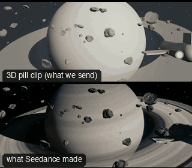

# SC05-SpaceFlyby: Space flyby



Family: Scenes.

**What it says.** Scale and speed: a small ship against an enormous world.

**Use it for.** Openings in space, travel, the arrival at a planet.

**Camera numbers.** Wide 35 mm, chase 28 mm, flyby 35 mm, recede 85 mm.

**Avoid.** Losing scale: keep the planet or a near rock in frame to measure the ship by.

## The three.js code

This is an excerpt of the template (9 lines, from `engine/cinematic/src/templates/scenes.ts`). `template.ts` in this folder is the same code with its imports. The helpers it calls (`make`, the actors, the rigs, the set and the post chain) are in `engine/cinematic/src`, so it does not run on its own: render it with `tools/render-pill.sh`.

```ts
import * as THREE from "three";
import { planner, scenePiece, type KitWorld, type SceneSpec, type ShotDef } from "../kit/stage";
import type { ActorSpec } from "../kit/actors";
import { GREY, clay } from "../kit/clay";
import { lag, rig } from "../kit/rigs";
import { aimFor } from "../framer";
import { asteroid, bench, broadTree, building, bush, car, carInterior, floorLamp, ground, lampPost, pine, planet, rock, room, scatter, shelf, sofa, table } from "../kit/props";
import { rng } from "../util";
import type { Piece } from "../piece";
import type { TemplateInfo } from "./cameras";

make({ id: "SC05-SpaceFlyby", name: "Space flyby", pattern: "Locked wide with the planet → chase drone → flyby pan → long-lens recede", says: "Scale and speed: a small ship against an enormous world.", use: "Openings in space, travel, the arrival at a planet.", numbers: "Wide 35 mm, chase 28 mm, flyby 35 mm, recede 85 mm.", avoid: "Losing scale: keep the planet or a near rock in frame to measure the ship by." },
    { sky: "space", build: buildSpace, keyDir: [0.7, 0.35, 0.6],
      actors: [{ id: "SHIP", name: "Ship", kind: "prop", model: "ship", tint: "plum", path: [{ t: 0, at: [50, 12, 60] }, { t: 17, at: [-150, -30, -560] }] }] },
    (P) => [
      { start: 0, end: 5, label: "35mm  LOCKED WIDE · THE PLANET", rig: "TRIPOD", subject: "SHIP", size: "EWS", stop: 8, cam: () => { const pos = V(46, 16, 96); return { pos, target: V(-700, -180, -2300), mm: 35 }; }, cut: "Opens on the planet", flags: ["centre"], shadow: 60 },
      { start: 5, end: 9.5, label: "28mm  CHASE DRONE", rig: "CHASE DRONE · GIMBAL", subject: "SHIP", size: "WS", stop: 5.6, cam: rig.chase(P("SHIP"), 17, 4.5, 28, 3, 1.0), cut: "CUT behind it, matched to its speed", flags: ["enters-moving", "exits-moving", "centre", "compound"], shadow: 40 },
      { start: 9.5, end: 13, label: "35mm  FLYBY PAN", rig: "TRIPOD · FLUID HEAD", subject: "SHIP", size: "WS", stop: 5.6, cam: (t) => { const pos = V(-70, -16, -380), e = lag((x) => P("SHIP")(x).eye, t, 0.12); return { pos, target: aimFor(pos, e, 35, [0, 0]), mm: 35 }; }, cut: "CUT ahead: it passes the lens", flags: ["enters-moving", "exits-moving", "centre", "compound"], shadow: 40 },
      { start: 13, end: 17, label: "85mm  LONG-LENS RECEDE", rig: "TRIPOD", subject: "SHIP", size: "EWS", stop: 8, cam: (t) => { const pos = V(-112, -2, -370), e = lag((x) => P("SHIP")(x).eye, t, 0.3); return { pos, target: aimFor(pos, e, 85, [0, 0]), mm: 85 }; }, cut: "CUT behind: it falls away toward the planet", flags: ["centre"], shadow: 60 },
    ]),
```

**Make it yours.** Change rig: `rig.chase`; lens: 35 mm, 85 mm; shot size: EWS, WS. The actor `path` entries say where the pill stands and walks, and the numbers after `rig.` set the move (distance, angle, rise, start and end time).

## The videos

The stand-in in `pill.mp4` is the **capsule** (the single striped capsule of the first gallery clips). Render the other with `--standin pin`.

| What | File |
|---|---|
| The 3D pill clip, the reference video (a re-render: the clip that was uploaded was not kept) | `pill.mp4` |
| What Seedance made from the pill clip (480p draft) | `release-media/SC05-SpaceFlyby/result.mp4` (release asset) |

## The prompt

One file per send. `sent.json` says, for each, whether it is the text that was sent, a recovered copy, or a rebuilt copy (`prompt.provenance`):

- `prompts/video.txt`

Keep the lines that say what the pills are and that the set is to be rebuilt as real. Change the person, the place and the light. These prompts come from the gallery runs and many predate the checks in `tools/seedance/`, so rebuild one with the gates before you reuse it.

## How it was sent

`sent.json` holds, for each send: the references in order with their roles, the settings, the credits and the outcome. Request ids are not kept; where one was known, a short hash is stored.

- **video #1**: 17 s, draft (480p preview), 21:9; references: @video1 = pill clip (the 3D blockout); confirmed: yes; 2478.6 credits.

See `reproduce.md` to render it and send it yourself.
