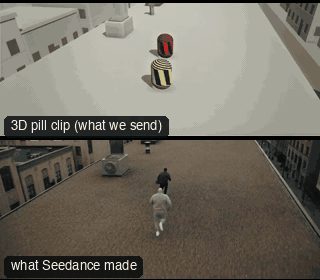

# SC06-RooftopChase: Rooftop chase



Family: Scenes.

**What it says.** One gets away, one is left at the edge: the gap between two roofs is the story.

**Use it for.** Foot chases, escapes, parkour, any pursuit with one obstacle that decides it.

**Camera numbers.** Chase drone 24 mm 9 m back and 4.5 m up, tracking 40 mm full figure at 5.8 m, snorricam 27 mm on a 2 m arm (the pursuer 3.7 m behind in the frame), the jump at 24 mm from a drone hovering off the roof with the world at 0.22× through the flight, OTS 50 mm, rise 24 mm to 4 m. Runners at 5 m/s; the jump 3.9 m across and 1 m down in 0.75 s, landed into a roll.

**Avoid.** Flipping screen direction: every camera stays on the near side of the run, so they always run left to right.

## The three.js code

This is an excerpt of the template (17 lines, from `engine/cinematic/src/templates/scenes2.ts`). `template.ts` in this folder is the same code with its imports. The helpers it calls (`make`, the actors, the rigs, the set and the post chain) are in `engine/cinematic/src`, so it does not run on its own: render it with `tools/render-pill.sh`.

```ts
import * as THREE from "three";
import { planner, scenePiece, speedRamp, type KitWorld, type SceneSpec, type ShotDef } from "../kit/stage";
import type { ActorSpec } from "../kit/actors";
import { GREY, clay, shadeAll } from "../kit/clay";
import { around, lag, rig, type Subj } from "../kit/rigs";
import { RIG_POSES } from "../kit/rig";
import { BakedSet } from "../kit/physics";
import { aimFor } from "../framer";
import { barrel, building, crate, ground, lampPost, shelf } from "../kit/props";
import { rng, smoother, ramp, lerp } from "../util";
import type { Piece } from "../piece";
import type { Cam } from "../shots";
import type { TemplateInfo } from "./cameras";
import { SCENE_INFO } from "./scenes";
import { BLAST, BRICK_AT, CAR_KEYS, CRASH, KB_IN, KEGS, KNOCK, densePath, kbLift, phys } from "./physics-specs";

make({ id: "SC06-RooftopChase", name: "Rooftop chase", pattern: "Chase drone geography → side tracking → snorricam → speed-ramped gap jump → OTS of the pursuer at the edge → drone rise",
    says: "One gets away, one is left at the edge: the gap between two roofs is the story.", use: "Foot chases, escapes, parkour, any pursuit with one obstacle that decides it.",
    numbers: "Chase drone 24 mm 9 m back and 4.5 m up, tracking 40 mm full figure at 5.8 m, snorricam 27 mm on a 2 m arm (the pursuer 3.7 m behind in the frame), the jump at 24 mm from a drone hovering off the roof with the world at 0.22× through the flight, OTS 50 mm, rise 24 mm to 4 m. Runners at 5 m/s; the jump 3.9 m across and 1 m down in 0.75 s, landed into a roll.",
    avoid: "Flipping screen direction: every camera stays on the near side of the run, so they always run left to right." },
    { sky: "day", build: buildRoofs, clock: roofClock, keyDir: [-0.45, 0.75, 0.5], motes: { center: [0, ROOF_A + 1, 0], size: [60, 5, 20], count: 260, drift: [0.6, 0.02, 0.1] },
      actors: [
        human("KIT", "Kit", "ochre", densePath((t) => [kitX(t), kitY(t), 0], -2, 17, 0.05), { acts: [clipFrom("Jump_Start", JUMP, 0.1, JUMP + 0.3), clip("Jump_Loop", JUMP + 0.4, JUMP + 0.68, 0.1), clip("Roll", JUMP + FLIGHT - 0.02, JUMP + FLIGHT + 0.8, 0.12)] }),
        human("ROOK", "Rook", "slate", densePath((t) => [rookX(t), ROOF_A, 0.7], -2, 17, 0.05), { acts: [{ kind: "lookDown", t0: 9.5, t1: 10.9, ease: 0.4 }], look: "KIT", lookFrom: 10.6 }),
      ] },
    (P) => [
      { start: 0, end: 3.6, label: "24mm  CHASE DRONE · GEOGRAPHY", rig: "CHASE DRONE · GIMBAL", subject: "ROOK", size: "WS", stop: 5.6, cam: rig.chase(P("ROOK"), 9, 4.5, 24, 2.5), cut: "Opens on the chase: both runners, the roof, the city", flags: ["enters-moving", "exits-moving", "centre"] },
      { start: 3.6, end: 5.9, label: "40mm  TRACKING · THE PURSUED", rig: "CABLECAM · HANDHELD HEAD", subject: "KIT", size: "FS", stop: 2.8, cam: rig.shake(rig.track(runner(P("KIT"), KIT_X0), { size: "FS", mm: 40, rise: 0.1 }, -1, 0.6), 1.5, 3), cut: "CUT in beside him: same direction of travel", flags: ["enters-moving", "exits-moving", "compound"] },
      { start: 5.9, end: 6.9, label: "27mm  SNORRICAM · THE GAP CLOSES", rig: "SNORRICAM · BODY RIG", subject: "KIT", size: "MS", stop: 2.8, cam: rig.shake((t) => { const K = runner(P("KIT"), KIT_X0)(t), c = rig.snorricam(P("KIT"), [0.35, 0.3, 2.0], 27)(t), b = K.eye.y - P("KIT")(t).eye.y; c.pos.y += b; return { ...c, target: aimFor(c.pos, K.eye, 27, [0.22, 1 / 3]), mm: 27 }; }, 1.6, 5), cut: "CUT to the body rig: the pursuer gains behind him", flags: ["enters-moving", "exits-moving", "centre", "compound"] },
      { start: 6.9, end: 10.15, label: "24mm  SPEED-RAMPED JUMP", rig: "DRONE · HOVER · PAN", subject: "KIT", size: "WS", stop: 4, cam: (t) => { const pos = V(1.2, ROOF_A + 3.6, 11.5), e = lag((x) => P("KIT")(x).eye, t, 0.1); return { pos, target: aimFor(pos, e, 24, [0, 0.1]), mm: 24 }; }, cut: "CUT wide off the roof: the gap opens under him, the world slows", flags: ["enters-moving", "exits-moving", "centre", "compound", "whip"], note: "a fast follow pan on a runner, which the pan rule exempts; flagged because the jump clip moves the head off the path the follow test reads" },
      { start: 10.15, end: 13.0, label: "50mm  OTS · THE PURSUER AT THE EDGE", rig: "STEADICAM", subject: "KIT", size: "MWS", sizeEnd: "WS", stop: 4, ots: "ROOK", cam: (t) => { const c = rig.ots(P("ROOK"), P("KIT"), 50, 1, 3.0, 0.6)(t); return { ...c, target: aimFor(c.pos, P("KIT")(11.3).eye, 50, [0.3, 0.25]) }; }, cut: "CUT behind the pursuer as he pulls up: the other is already away", flags: ["enters-moving", "short-side"] },
      { start: 13.0, end: 17.0, label: "24mm  DRONE RISE · RELEASE", rig: "DRONE", subject: "ROOK", size: "WS", sizeEnd: "EWS", stop: 5.6, cam: (t) => { const c = rig.crane(P("ROOK"), { size: "WS", mm: 24, deg: -165 }, 1.2, 4.2, 13, 17, 1.8)(t); return { ...c, target: V(12, ROOF_B - 1.6, 0.4) }; }, cut: "CUT wide behind him: the drone climbs away, he is left alone", flags: ["compound", "centre"] },
    ]),
```

**Make it yours.** Change rig: `rig.chase`, `rig.crane`, `rig.ots`, `rig.shake`, `rig.snorricam`, `rig.track`; lens: 24 mm, 27 mm, 40 mm; shot size: FS, MS, MWS, WS. The actor `path` entries say where the pill stands and walks, and the numbers after `rig.` set the move (distance, angle, rise, start and end time).

## The videos

The stand-in in `pill.mp4` is the **capsule** (the single striped capsule of the first gallery clips). Render the other with `--standin pin`.

| What | File |
|---|---|
| The 3D pill clip, the reference video (a re-render: the clip that was uploaded was not kept) | `pill.mp4` |
| What Seedance made from the pill clip (480p draft) | `release-media/SC06-RooftopChase/result.mp4` (release asset) |

## The prompt

One file per send. `sent.json` says, for each, whether it is the text that was sent, a recovered copy, or a rebuilt copy (`prompt.provenance`):

- `prompts/video.txt`

Keep the lines that say what the pills are and that the set is to be rebuilt as real. Change the person, the place and the light. These prompts come from the gallery runs and many predate the checks in `tools/seedance/`, so rebuild one with the gates before you reuse it.

## How it was sent

`sent.json` holds, for each send: the references in order with their roles, the settings, the credits and the outcome. Request ids are not kept; where one was known, a short hash is stored.

- **video #1**: 17 s, draft (480p preview), 21:9; references: @video1 = pill clip (the 3D blockout), @image1 = person photo (face reference); confirmed: yes; 2478.6 credits.

See `reproduce.md` to render it and send it yourself.
