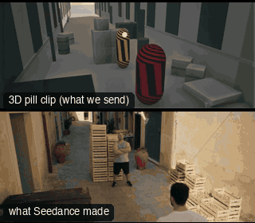

# SC07-AlleyFight: Alley fight



Family: Scenes.

**What it says.** Who hits whom, and what it costs: the crates behind him are shown before he goes into them.

**Use it for.** Fist fights, brawls, any two-person fight in a tight space.

**Camera numbers.** Master 24 mm from 3 m up, OTS 50 mm 3 m back (the shoulder a third), single 35 mm, crash zoom 32→100 mm in 0.24 s from 3 m, low wide 20 mm handheld at 0.45 m, crane up to 5.4 m on 24 mm. Fighters 0.95 m apart, punches land at their measured reach.

**Avoid.** Cutting before the blow completes, or crossing the line between the fighters: every camera is on their left.

## The three.js code

This is an excerpt of the template (26 lines, from `engine/cinematic/src/templates/scenes2.ts`). `template.ts` in this folder is the same code with its imports. The helpers it calls (`make`, the actors, the rigs, the set and the post chain) are in `engine/cinematic/src`, so it does not run on its own: render it with `tools/render-pill.sh`.

```ts
import * as THREE from "three";
import { planner, scenePiece, speedRamp, type KitWorld, type SceneSpec, type ShotDef } from "../kit/stage";
import type { ActorSpec } from "../kit/actors";
import { GREY, clay, shadeAll } from "../kit/clay";
import { around, lag, rig, type Subj } from "../kit/rigs";
import { RIG_POSES } from "../kit/rig";
import { BakedSet } from "../kit/physics";
import { aimFor } from "../framer";
import { barrel, building, crate, ground, lampPost, shelf } from "../kit/props";
import { rng, smoother, ramp, lerp } from "../util";
import type { Piece } from "../piece";
import type { Cam } from "../shots";
import type { TemplateInfo } from "./cameras";
import { SCENE_INFO } from "./scenes";
import { BLAST, BRICK_AT, CAR_KEYS, CRASH, KB_IN, KEGS, KNOCK, densePath, kbLift, phys } from "./physics-specs";

make({ id: "SC07-AlleyFight", name: "Alley fight", pattern: "Wide master → OTS over the attacker → single on him → crash-zoom insert on the blow → low handheld wide on the knockback → crane up, release",
    says: "Who hits whom, and what it costs: the crates behind him are shown before he goes into them.", use: "Fist fights, brawls, any two-person fight in a tight space.",
    numbers: "Master 24 mm from 3 m up, OTS 50 mm 3 m back (the shoulder a third), single 35 mm, crash zoom 32→100 mm in 0.24 s from 3 m, low wide 20 mm handheld at 0.45 m, crane up to 5.4 m on 24 mm. Fighters 0.95 m apart, punches land at their measured reach.",
    avoid: "Cutting before the blow completes, or crossing the line between the fighters: every camera is on their left." },
    { sky: "day", build: buildAlley, tick: tickDebris, keyDir: [0.35, 0.82, 0.45], motes: { center: [0, 1.6, 0], size: [5.6, 3, 14], count: 240, drift: [0.03, 0.02, 0.12] },
      actors: [
        human("VIC", "Vic", "ochre", walkPath([{ t0: 0.1, t1: 2.5, from: [0.3, 3.0], to: [0.3, 0.95] }, { t0: 12.4, t1: 15.9, from: [0.3, 0.95], to: [0.15, 5.0] }], -1, 16).map((k) => (k.t > 2.9 && k.t < 11.7 ? { ...k, yaw: Math.PI } : k.t >= 11.8 && k.t < 12.4 ? { ...k, yaw: 0.05 } : k)),
          { acts: [clip("Hit_Chest", 3.9, 4.3, 0.05), clip("Punch_Jab", 5.7, 6.55), clip("Hit_Head", 7.02, 7.45, 0.05), clip("Punch_Cross", 8.0, 9.0)], look: "BRICK", lookFrom: 0, lookTo: 11.6 }),
        human("BRICK", "Brick", "slate", densePath((t) => [BRICK_AT[0], kbLift(t, KNOCK), BRICK_AT[1]], -1, 16, 0.02).map((k) => ({ ...k, yaw: 0 })),
          { acts: [clip("Idle_FoldArms_Loop", -1, 1.8, 0.5), clip("Punch_Cross", 3.6, 4.6), clip("Hit_Head", 5.92, 6.35, 0.05), clip("Punch_Jab", 6.8, 7.65), clip("Hit_Knockback", KNOCK, undefined, 0.04)], look: "VIC", lookFrom: 0, lookTo: KNOCK }),
      ] },
    (P) => {
      const OTS_B = 3.0, OTS_O = 1.0, OTS_X = 0.5;   // the OTS over Vic: far enough back that his shoulder keeps to a third, Brick framed off it
      const BR = P("BRICK"), VI = P("VIC"), M = V(-1.6, 2.9, 7.2), Z = V(-2.7, 1.55, 0.2), LOW = V(-1.7, 0.45, 2.1);
      return [
        { start: 0, end: 3.3, label: "24mm  WIDE MASTER", rig: "TRIPOD", subject: "VIC", size: "WS", stop: 4, pair: ["VIC", "BRICK"], cam: fixed(M, V(0.3, 0.75, 0.6), 24), cut: "Opens on the alley: the crates behind him first", flags: ["centre"] },
        { start: 3.3, end: 5.4, label: "50mm  OTS · VIC ON BRICK", rig: "STEADICAM", subject: "BRICK", size: "MS", stop: 2.8, ots: "VIC", pair: ["VIC", "BRICK"], cam: (t) => { const c = rig.ots(P("VIC"), P("BRICK"), 50, -1, OTS_B, OTS_O)(t); return { ...c, target: aimFor(c.pos, drop(P("BRICK"), 0.055)(t).eye, 50, [-OTS_X, 1 / 3]) }; }, cut: "CUT in over his shoulder: the punch comes at us", flags: ["short-side"], note: "the swing turns his head off the line for a beat" },
        { start: 5.4, end: 7.5, label: "35mm  SINGLE · VIC", rig: "STEADICAM", subject: "VIC", size: "MWS", stop: 2.8, pair: ["VIC", "BRICK"], cam: rig.locked(drop(P("VIC"), 0.04), { size: "MWS", mm: 35, deg: 58 }, 6.0), cut: "CUT round to him, the answer and the reply (same side of the line)" },
        { start: 7.5, end: 8.25, label: "32→100mm  CRASH ZOOM · THE HIT", rig: "TRIPOD · ZOOM", subject: "BRICK", size: "MWS", sizeEnd: "CU", stop: 2.8, pair: ["VIC", "BRICK"], cam: (t) => { const k = smoother(ramp(t, 7.96, 8.2)), mm = 32 * Math.pow(100 / 32, k); return { pos: Z.clone(), target: aimFor(Z, BR(t).eye.add(V(0, -0.04, 0)), mm, [0, 1 / 3]), mm }; }, cut: "CUT side-on as he loads the cross: the lens slams in on the blow", flags: ["exits-moving", "centre", "whip"], note: "a crash zoom is a snap by design: the aim re-centres as the lens narrows" },
        { start: 8.25, end: 11.2, label: "20mm  LOW HANDHELD · INTO THE CRATES", rig: "HANDHELD · LOW", subject: "BRICK", size: "FS", stop: 4, pair: ["VIC", "BRICK"], cam: rig.shake(fixed(LOW, V(0.3, 0.8, -0.75), 20), 3, 2), cut: "CUT low on the blow itself: it folds him and throws him back into the stack", flags: ["centre"] },
        { start: 11.2, end: 15.625, label: "24mm  CRANE UP · RELEASE", rig: "TECHNOCRANE", subject: "VIC", size: "WS", stop: 5.6, pair: ["VIC", "BRICK"], cam: (() => {
          const up = (t: number) => ({ pos: V(-2.5, 3.4, -4.2).lerp(V(-2.0, 5.4, -5.8), smoother(ramp(t, 11.75, 15.6))) });
          return (t: number): Cam => { const pos = up(t).pos, e = lag((x) => VI(x).eye, t, 0.3); return { pos, target: aimFor(pos, e, 24, [0, 0.12]), mm: 24 }; };
        })(), cut: "CUT behind the wreck: the crane rises as he walks away", flags: ["compound", "centre", "exits-moving"] },
      ];
    }),
```

**Make it yours.** Change rig: `rig.locked`, `rig.ots`, `rig.shake`; lens: 24 mm, 35 mm; shot size: FS, MS, MWS, WS. The actor `path` entries say where the pill stands and walks, and the numbers after `rig.` set the move (distance, angle, rise, start and end time).

## The videos

The stand-in in `pill.mp4` is the **capsule** (the single striped capsule of the first gallery clips). Render the other with `--standin pin`.

| What | File |
|---|---|
| The 3D pill clip, the reference video (a re-render: the clip that was uploaded was not kept) | `pill.mp4` |
| What Seedance made from the pill clip (480p draft) | `release-media/SC07-AlleyFight/result.mp4` (release asset) |
| Camera only, no subject | `release-media/SC07-AlleyFight/plate.mp4` and what it made: `release-media/SC07-AlleyFight/plate-made.mp4` |
| The same move in other looks (ink, pencil, ghost, plate, boxes, clay, hand) | `release-media/SC07-AlleyFight/looks/` |

## The prompt

One file per send. `sent.json` says, for each, whether it is the text that was sent, a recovered copy, or a rebuilt copy (`prompt.provenance`):

- `prompts/camera-only-video.txt`
- `prompts/video.txt`

Keep the lines that say what the pills are and that the set is to be rebuilt as real. Change the person, the place and the light. These prompts come from the gallery runs and many predate the checks in `tools/seedance/`, so rebuild one with the gates before you reuse it.

## How it was sent

`sent.json` holds, for each send: the references in order with their roles, the settings, the credits and the outcome. Request ids are not kept; where one was known, a short hash is stored.

- **video #1**: 16 s, draft (480p preview), 21:9; references: @video1 = pill clip (the 3D blockout), @image1 = person photo (face reference); confirmed: yes; 2332.8 credits.
- **camera-only-video #1**: 16 s, draft (480p preview), 21:9; references: @video1 = pill clip (the 3D blockout), @image1 = person photo (face reference); confirmed: yes; 2332.8 credits.

See `reproduce.md` to render it and send it yourself.
