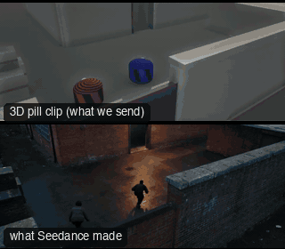

# SC08-HeistApproach: Heist approach



Family: Scenes.

**What it says.** Getting in unseen: the wall, the walk, the door, and the one who keeps watch.

**Use it for.** Heists, infiltrations, stealth, any scene where being seen is the threat.

**Camera numbers.** Crane over the wall 28 mm from 5.3 m outside to 2.1 m inside, tracking 40 mm on the crouch-walk (0.72 m/s, paced to the clip), locked 32 mm at the door, POV 32 mm handheld at crouched eye height, the door frame in the frame, lookout hold 85 mm, high wide 40 mm from over the wall.

**Avoid.** Showing the guard before the POV: the doorway is where we learn he is there.

## The three.js code

This is an excerpt of the template (23 lines, from `engine/cinematic/src/templates/scenes2.ts`). `template.ts` in this folder is the same code with its imports. The helpers it calls (`make`, the actors, the rigs, the set and the post chain) are in `engine/cinematic/src`, so it does not run on its own: render it with `tools/render-pill.sh`.

```ts
import * as THREE from "three";
import { planner, scenePiece, speedRamp, type KitWorld, type SceneSpec, type ShotDef } from "../kit/stage";
import type { ActorSpec } from "../kit/actors";
import { GREY, clay, shadeAll } from "../kit/clay";
import { around, lag, rig, type Subj } from "../kit/rigs";
import { RIG_POSES } from "../kit/rig";
import { BakedSet } from "../kit/physics";
import { aimFor } from "../framer";
import { barrel, building, crate, ground, lampPost, shelf } from "../kit/props";
import { rng, smoother, ramp, lerp } from "../util";
import type { Piece } from "../piece";
import type { Cam } from "../shots";
import type { TemplateInfo } from "./cameras";
import { SCENE_INFO } from "./scenes";
import { BLAST, BRICK_AT, CAR_KEYS, CRASH, KB_IN, KEGS, KNOCK, densePath, kbLift, phys } from "./physics-specs";

make({ id: "SC08-HeistApproach", name: "Heist approach", pattern: "Crane over the wall → crouch-walk tracking → locked at the door → POV through the doorway → hold on the lookout → high wide as he slips in",
    says: "Getting in unseen: the wall, the walk, the door, and the one who keeps watch.", use: "Heists, infiltrations, stealth, any scene where being seen is the threat.",
    numbers: "Crane over the wall 28 mm from 5.3 m outside to 2.1 m inside, tracking 40 mm on the crouch-walk (0.72 m/s, paced to the clip), locked 32 mm at the door, POV 32 mm handheld at crouched eye height, the door frame in the frame, lookout hold 85 mm, high wide 40 mm from over the wall.",
    avoid: "Showing the guard before the POV: the doorway is where we learn he is there." },
    { sky: "dusk", build: buildCompound, keyDir: [0.6, 0.55, -0.6], motes: { center: [0, 1.5, -5], size: [20, 3, 16], count: 220, drift: [0.06, 0.01, -0.04] },
      actors: [
        human("NYX", "Nyx", "sage", nyxPath, { acts: [clip("Crouch_Fwd_Loop", -2, NYX_AT, 0.15), clip("Crouch_Idle_Loop", NYX_AT + 0.05, 15.8, 0.3)] }),
        human("ASH", "Ash", "plum", ashPath, { acts: [clip("Crouch_Fwd_Loop", -2, ASH_AT, 0.15)], look: [-7.5, 1.3, 0.6], lookFrom: 14.5 }),
        human("GUARD", "Guard", "rose", walkPath([{ t0: 6.2, t1: 17.4, from: [9.6, -14.6], to: [-1.8, -14.6] }], -1, 21)),
      ] },
    (P) => {
      const crouchN = (t: number) => (t < 15.8 ? 1 : 1 - smoother((t - 15.8) / 0.4)), crouchA = (t: number) => (t < ASH_AT ? 1 : 1 - smoother((t - ASH_AT) / 0.3));
      const N = lowered(P("NYX"), crouchN), A = lowered(P("ASH"), crouchA), G = P("GUARD");
      const POV = V(2, 0.95, -7.98), HIGH = V(-6, 5.2, 1.6), C0 = V(-6.8, 4.95, 3.4), C1 = V(-5.4, 2.4, -1.4);
      return [
        { start: 0, end: 4.5, label: "28mm  CRANE OVER THE WALL", rig: "TECHNOCRANE", subject: "NYX", size: "WS", stop: 2.8, cam: (t) => { const pos = C0.clone().lerp(C1, smoother(ramp(t, 0.35, 4.25))), e = lag((x) => N(x).eye, t, 0.3); return { pos, target: aimFor(pos, e, 28, [0, 0]), mm: 28 }; }, cut: "Opens outside the wall: the crane rises over it and drops in on them", flags: ["compound", "centre"] },
        { start: 4.5, end: 7.8, label: "40mm  TRACKING · CROUCH-WALK", rig: "DOLLY · HANDHELD HEAD", subject: "NYX", size: "FS", stop: 2, cam: rig.shake(rig.track(N, { size: "FS", mm: 40, rise: 0.25 }, -1, 0.5), 1, 7), cut: "CUT down beside him: low, at their pace", flags: ["enters-moving", "exits-moving"] },
        { start: 7.8, end: 11.0, label: "32mm  LOCKED · THE DOOR", rig: "TRIPOD", subject: "NYX", size: "FS", stop: 2.8, cam: rig.locked(N, { size: "FS", mm: 32, deg: -85, rise: 0.25 }, 10.6), cut: "CUT ahead to the door: he crouch-walks into his frame and stops on his mark", flags: ["centre"] },
        { start: 11.0, end: 14.0, label: "32mm  POV · THROUGH THE DOORWAY", rig: "HANDHELD", subject: "GUARD", size: "WS", stop: 2, cam: rig.shake((t) => { const look = V(2, 1.2, -16).lerp(lag((x) => G(x).eye, t, 0.8), 0.45); return { pos: POV.clone(), target: aimFor(POV, look, 32, [0, 0]), mm: 32 }; }, 1.2, 9), cut: "CUT to what he sees: someone inside", flags: ["centre"] },
        { start: 14.0, end: 16.4, label: "85mm  HOLD · THE LOOKOUT", rig: "TRIPOD", subject: "ASH", size: "MCU", stop: 2, cam: rig.locked(drop(A, 0.03), { size: "MCU", mm: 85, deg: 70, rise: 0 }, 14.0), cut: "CUT to her: she holds, then her head turns to the gate" },
        { start: 16.4, end: 19.25, label: "40mm  HIGH WIDE · IN", rig: "TECHNOCRANE · LOCKED", subject: (t) => (t < 18.4 ? "NYX" : "ASH"), size: "WS", stop: 4, cam: fixed(HIGH, V(0.6, 0.9, -9.6), 40), cut: "CUT high over the wall: he rises and slips into the dark; she stays", flags: ["centre"] },
      ];
    }),
```

**Make it yours.** Change rig: `rig.locked`, `rig.shake`, `rig.track`; lens: 28 mm, 32 mm, 40 mm, 85 mm; shot size: FS, MCU, WS. The actor `path` entries say where the pill stands and walks, and the numbers after `rig.` set the move (distance, angle, rise, start and end time).

## The videos

The stand-in in `pill.mp4` is the **capsule** (the single striped capsule of the first gallery clips). Render the other with `--standin pin`.

| What | File |
|---|---|
| The 3D pill clip, the reference video | `pill.mp4` |
| The contact sheet (sketch route) | `sketch-sheet.jpg` |
| What Seedance made from the pill clip (480p draft) | `release-media/SC08-HeistApproach/result.mp4` (release asset) |
| What Seedance made from the contact sheet | `release-media/SC08-HeistApproach/sketch-output.mp4` (release asset) |
| Another take from the same template | `release-media/SC08-HeistApproach/ink-sketch-ink-sc08.mp4` |

## The prompt

One file per send. `sent.json` says, for each, whether it is the text that was sent, a recovered copy, or a rebuilt copy (`prompt.provenance`):

- `prompts/ink-sketch-recovered-sheet.txt`
- `prompts/sketch.txt`
- `prompts/video-1.txt`
- `prompts/video-2.txt`

Keep the lines that say what the pills are and that the set is to be rebuilt as real. Change the person, the place and the light. These prompts come from the gallery runs and many predate the checks in `tools/seedance/`, so rebuild one with the gates before you reuse it.

## How it was sent

`sent.json` holds, for each send: the references in order with their roles, the settings, the credits and the outcome. Request ids are not kept; where one was known, a short hash is stored.

- **video #1**: 20 s, draft (480p preview), 21:9; references: @video1 = pill clip (the 3D blockout), @image1 = person photo (face reference); confirmed: no receipt.
- **video #2**: 20 s, draft (480p preview), 21:9; references: @video1 = pill clip (the 3D blockout), @image1 = person photo (face reference); confirmed: yes; 2843.1 credits.
- **sketch #1**: 20 s, draft (480p preview), 21:9; references: @image1 = person photo (face reference), @image2 = contact sheet of the pill (a few frames on one image); confirmed: yes; 2444 credits.
- **ink-sketch #1**: 20 s, draft (480p preview), 21:9; references: @image1 = person photo (face reference), @image2 = pill contact sheet (the sketch route); confirmed: yes; 2444 credits.

See `reproduce.md` to render it and send it yourself.
