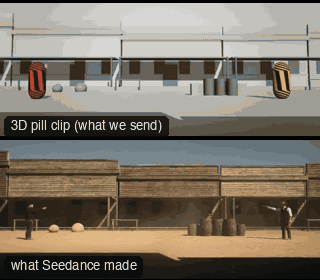

# SC09-StandoffDebris: Stand-off



Family: Scenes.

**What it says.** Two people, one street, a wait; it ends in one shot that hits what we were shown at the start.

**Use it for.** Stand-offs, duels, any held tension that breaks into violence.

**Camera numbers.** Wide 24 mm low, matched dolly pushes on 75 mm MS→CU about 50° off the line, ECU 135 mm from 2.2 m, the shot 50 mm MS, impact wide 24 mm with the world at 0.2× for 3 s.

**Avoid.** Pushing faster than the tension: the push is the acting, so it creeps. Show the kegs in the first wide.

## The three.js code

This is an excerpt of the template (28 lines, from `engine/cinematic/src/templates/scenes2.ts`). `template.ts` in this folder is the same code with its imports. The helpers it calls (`make`, the actors, the rigs, the set and the post chain) are in `engine/cinematic/src`, so it does not run on its own: render it with `tools/render-pill.sh`.

```ts
import * as THREE from "three";
import { planner, scenePiece, speedRamp, type KitWorld, type SceneSpec, type ShotDef } from "../kit/stage";
import type { ActorSpec } from "../kit/actors";
import { GREY, clay, shadeAll } from "../kit/clay";
import { around, lag, rig, type Subj } from "../kit/rigs";
import { RIG_POSES } from "../kit/rig";
import { BakedSet } from "../kit/physics";
import { aimFor } from "../framer";
import { barrel, building, crate, ground, lampPost, shelf } from "../kit/props";
import { rng, smoother, ramp, lerp } from "../util";
import type { Piece } from "../piece";
import type { Cam } from "../shots";
import type { TemplateInfo } from "./cameras";
import { SCENE_INFO } from "./scenes";
import { BLAST, BRICK_AT, CAR_KEYS, CRASH, KB_IN, KEGS, KNOCK, densePath, kbLift, phys } from "./physics-specs";

make({ id: "SC09-StandoffDebris", name: "Stand-off", pattern: "Profile wide with the kegs in it → slow push on one → matched push on the other → ECU on long lens → the shot → speed-ramped impact",
    says: "Two people, one street, a wait; it ends in one shot that hits what we were shown at the start.", use: "Stand-offs, duels, any held tension that breaks into violence.",
    numbers: "Wide 24 mm low, matched dolly pushes on 75 mm MS→CU about 50° off the line, ECU 135 mm from 2.2 m, the shot 50 mm MS, impact wide 24 mm with the world at 0.2× for 3 s.",
    avoid: "Pushing faster than the tension: the push is the acting, so it creeps. Show the kegs in the first wide." },
    { sky: "day", build: buildWestern, clock: westernClock, keyDir: [0.25, 0.62, 0.74],
      tick: (w, t) => {
        tickDebris(w, t); tickPuffs(w, "blast", t, BLAST, 7);
        const f = w.parts.get("flash")!; f.visible = t > BLAST && t < BLAST + 0.09; if (f.visible) f.scale.setScalar(0.6 + 14 * (t - BLAST));
        pistols(w, t, ["COLE", "REYES"], { COLE: [BLAST - 0.16, BLAST - 0.1] });
      },
      motes: { center: [0, 1.2, 0], size: [40, 2.4, 20], count: 300, drift: [0.5, 0.02, 0.08] },
      actors: [
        human("COLE", "Cole", "sand", [{ t: 0, at: [-6, 0], yaw: Math.PI / 2 }, { t: 13.2, at: [-6, 0], yaw: Math.PI / 2 }, { t: 13.6, at: [-6, 0], yaw: Math.PI / 2 - 0.2 }],
          { acts: [clip("Pistol_Idle_Loop", -1, 13.3, 0.3), clip("Pistol_Aim_Neutral", 13.35, 13.8, 0.12), clip("Pistol_Shoot", BLAST - 0.17)], look: "REYES", lookFrom: 0, lookTo: 13.4 }),
        human("REYES", "Reyes", "slate", densePath((t) => [6, kbLift(t, BLAST + 0.03 - KB_IN), 0], -1, 22, 0.02).map((k) => ({ ...k, yaw: -Math.PI / 2 })),
          { acts: [clip("Pistol_Idle_Loop", -1, 13.45, 0.3), clip("Pistol_Aim_Neutral", 13.5, BLAST + 0.02, 0.15), clipFrom("Hit_Knockback", BLAST + 0.03, KB_IN)], look: "COLE", lookFrom: 0, lookTo: BLAST }),
      ] },
    (P) => {
      const W = V(0, 0.85, 10.3), R = V(-0.8, 0.55, 8.6);
      return [
        { start: 0, end: 4.2, label: "24mm  PROFILE WIDE · THE STREET", rig: "TRIPOD · LOW HAT", subject: "COLE", size: "WS", stop: 5.6, pair: ["COLE", "REYES"], cam: fixed(W, V(0, 1.4, 0), 24), cut: "Opens on the street: both of them, and the kegs", flags: ["centre"] },
        { start: 4.2, end: 8.4, label: "75mm  SLOW PUSH · COLE", rig: "DOLLY", subject: "COLE", size: "MS", sizeEnd: "CU", stop: 2.8, pair: ["COLE", "REYES"], cam: rig.dolly(drop(P("COLE"), 0.05), { size: "MS", mm: 75, deg: -58, rise: 0.4 }, "CU", 4.2, 8.4, 0.5), cut: "CUT in to him: the push begins the wait" },
        { start: 8.4, end: 12.6, label: "75mm  SLOW PUSH · REYES", rig: "DOLLY", subject: "REYES", size: "MS", sizeEnd: "CU", stop: 2.8, pair: ["COLE", "REYES"], reverse: 2, cam: rig.dolly(drop(P("REYES"), 0.05), { size: "MS", mm: 75, deg: 50, rise: -0.1 }, "CU", 8.4, 12.6, 0.5), cut: "CUT to the other: the matched push" },
        { start: 12.6, end: 13.3, label: "135mm  ECU · LONG LENS", rig: "TRIPOD", subject: "COLE", size: "ECU", stop: 2.8, pair: ["COLE", "REYES"], cam: (t) => { const m = P("COLE")(12.9), pos = m.eye.clone().add(around(m, -40).multiplyScalar(2.2)); return { pos, target: aimFor(pos, P("COLE")(t).eye, 135, [-0.12, 0.08]), mm: 135 }; }, cut: "CUT to his eyes, flat on the long lens" },
        { start: 13.3, end: 14.1, label: "50mm  MS · THE SHOT", rig: "TRIPOD", subject: "COLE", size: "MS", stop: 2.8, pair: ["COLE", "REYES"], cam: rig.locked(drop(P("COLE"), 0.03), { size: "MS", mm: 50, deg: -78, rise: -0.1 }, 13.6), cut: "CUT wider as his arm moves: he swings off Reyes and fires at the kegs", flags: ["short-side"] },
        { start: 14.1, end: 19.0, label: "24mm  IMPACT · SPEED RAMP", rig: "DOLLY · LOW", subject: "REYES", size: "WS", stop: 5.6, pair: ["COLE", "REYES"], cam: (t) => { const k = smoother(ramp(t, 14.1, 19)), pos = R.clone().lerp(V(0.2, 0.6, 7.2), k); return { pos, target: aimFor(pos, V(4.4, 1.3, -1.6), 24, [0, 0]), mm: 24 }; }, cut: "CUT wide on the blast: the world slows as the kegs go up", flags: ["centre", "enters-moving"] },
      ];
    }),
```

**Make it yours.** Change rig: `rig.dolly`, `rig.locked`; lens: 24 mm, 50 mm, 75 mm, 135 mm; shot size: ECU, MS, WS. The actor `path` entries say where the pill stands and walks, and the numbers after `rig.` set the move (distance, angle, rise, start and end time).

## The videos

The stand-in in `pill.mp4` is the **capsule** (the single striped capsule of the first gallery clips). Render the other with `--standin pin`.

| What | File |
|---|---|
| The 3D pill clip, the reference video (a re-render: the clip that was uploaded was not kept) | `pill.mp4` |
| The contact sheet (sketch route) | `sketch-sheet.jpg` |
| What Seedance made from the pill clip (480p draft) | `release-media/SC09-StandoffDebris/result.mp4` (release asset) |
| What Seedance made from the contact sheet | `release-media/SC09-StandoffDebris/sketch-output.mp4` (release asset) |
| Another take from the same template | `release-media/SC09-StandoffDebris/ink-sketch-ink-sc09-photo.mp4` |

## The prompt

One file per send. `sent.json` says, for each, whether it is the text that was sent, a recovered copy, or a rebuilt copy (`prompt.provenance`):

- `prompts/ink-sketch-recovered-sheet.txt`
- `prompts/video.txt`

Keep the lines that say what the pills are and that the set is to be rebuilt as real. Change the person, the place and the light. These prompts come from the gallery runs and many predate the checks in `tools/seedance/`, so rebuild one with the gates before you reuse it.

## How it was sent

`sent.json` holds, for each send: the references in order with their roles, the settings, the credits and the outcome. Request ids are not kept; where one was known, a short hash is stored.

- **video #1**: 19 s, draft (480p preview), 21:9; references: @video1 = pill clip (the 3D blockout), @image1 = person photo (face reference); confirmed: yes; 2770.2 credits.
- **ink-sketch #1**: 19 s, draft (480p preview), 21:9; references: @image1 = person photo (face reference), @image2 = pill contact sheet (the sketch route); confirmed: yes; 2321.8 credits.

See `reproduce.md` to render it and send it yourself.
