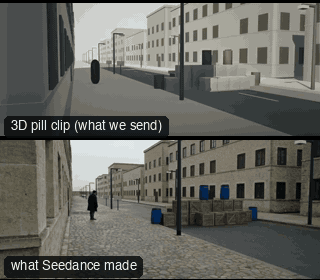

# SC10-CarCrashBarrier: Car through the barrier



Family: Scenes.

**What it says.** Something unstoppable meets something in its way; someone watches it happen from just far enough away.

**Use it for.** Crashes, breakthroughs, roadblocks, any vehicle impact.

**Camera numbers.** Wide 24 mm, tracking 20 mm at 0.4 m off the road and 16 m/s, MCU 65 mm, impact wide 35 mm from 27 m up the road, replay 24 mm from 9 m off the barrier with the world at 0.2× from 0.25 s before the hit, aftermath 32 mm.

**Avoid.** Breaking the car's screen direction: every camera sits on the bystander's side of the road.

## The three.js code

This is an excerpt of the template (22 lines, from `engine/cinematic/src/templates/scenes2.ts`). `template.ts` in this folder is the same code with its imports. The helpers it calls (`make`, the actors, the rigs, the set and the post chain) are in `engine/cinematic/src`, so it does not run on its own: render it with `tools/render-pill.sh`.

```ts
import * as THREE from "three";
import { planner, scenePiece, speedRamp, type KitWorld, type SceneSpec, type ShotDef } from "../kit/stage";
import type { ActorSpec } from "../kit/actors";
import { GREY, clay, shadeAll } from "../kit/clay";
import { around, lag, rig, type Subj } from "../kit/rigs";
import { RIG_POSES } from "../kit/rig";
import { BakedSet } from "../kit/physics";
import { aimFor } from "../framer";
import { barrel, building, crate, ground, lampPost, shelf } from "../kit/props";
import { rng, smoother, ramp, lerp } from "../util";
import type { Piece } from "../piece";
import type { Cam } from "../shots";
import type { TemplateInfo } from "./cameras";
import { SCENE_INFO } from "./scenes";
import { BLAST, BRICK_AT, CAR_KEYS, CRASH, KB_IN, KEGS, KNOCK, densePath, kbLift, phys } from "./physics-specs";

make({ id: "SC10-CarCrashBarrier", name: "Car through the barrier", pattern: "Locked wide with the barrier → low tracking on the car → the bystander sees it → locked-off wide on the impact → slow-motion replay angle → aftermath",
    says: "Something unstoppable meets something in its way; someone watches it happen from just far enough away.", use: "Crashes, breakthroughs, roadblocks, any vehicle impact.",
    numbers: "Wide 24 mm, tracking 20 mm at 0.4 m off the road and 16 m/s, MCU 65 mm, impact wide 35 mm from 27 m up the road, replay 24 mm from 9 m off the barrier with the world at 0.2× from 0.25 s before the hit, aftermath 32 mm.",
    avoid: "Breaking the car's screen direction: every camera sits on the bystander's side of the road." },
    { sky: "day", build: buildRoadblock, clock: crashClock, keyDir: [-0.5, 0.7, 0.5], motes: { center: [0, 1.2, 0], size: [20, 2.4, 30], count: 220, drift: [0.15, 0.02, 0.2] },
      tick: (w, t) => { tickDebris(w, t); tickPuffs(w, "dust", t, CRASH, 3.5); },
      actors: [
        { id: "CAR", name: "Car", kind: "prop", model: "car", tint: "sand", path: CAR_KEYS },
        human("LENA", "Lena", "rose", walkPath([{ t0: CRASH + 1.05, t1: CRASH + 2.9, from: [-7.4, -4], to: [-7.2, -6.2] }], -1, 18).map((k) => (k.t < CRASH + 0.5 ? { ...k, yaw: Math.PI / 2 } : k.t < CRASH + 1.05 ? { ...k, yaw: Math.PI - 0.09 } : k.t > CRASH + 3.1 ? { ...k, yaw: 0.78 } : k)),
          { acts: [clip("Hit_Chest", CRASH + 0.12, CRASH + 0.55)], look: "CAR", lookFrom: 5.8, lookTo: CRASH + 0.6 }),
      ] },
    (P) => {
      const C = P("CAR");
      return [
        { start: 0, end: 3.5, label: "24mm  LOCKED WIDE · THE BARRIER", rig: "TRIPOD", subject: "LENA", size: "WS", stop: 5.6, cam: fixed(V(-8.8, 2.0, 12.5), V(-1.5, 1.0, -6), 24), cut: "Opens on the road: the barrier, her, the car far off", flags: ["centre"] },
        { start: 3.5, end: 6.5, label: "20mm  LOW TRACKING · THE CAR", rig: "CAMERA CAR · LOW MOUNT", subject: "CAR", size: "WS", stop: 4, cam: rig.shake(rig.track(C, { size: "WS", mm: 20, rise: -0.4 }, -1, 1.2), 1.2, 4), cut: "CUT low beside it: speed, the lamp posts streaming past", flags: ["enters-moving", "exits-moving"] },
        { start: 6.5, end: 8.3, label: "65mm  MCU · SHE SEES IT", rig: "TRIPOD", subject: "LENA", size: "MCU", stop: 2.8, cam: rig.locked(drop(P("LENA"), 0.03), { size: "MCU", mm: 65, deg: 38 }, 7.6), cut: "CUT to her: her head turns to it", flags: ["short-side"] },
        { start: 8.3, end: 10.04, label: "35mm  LOCKED-OFF WIDE · IMPACT", rig: "TRIPOD", subject: "CAR", size: "WS", stop: 5.6, cam: fixed(V(-1.2, 1.9, 27), V(0.6, 0.9, 0), 35), cut: "CUT up the road: it hits in real time", flags: ["centre", "wipe"], note: "the barrier stands between the lens and the car until the car comes through it" },
        { start: 10.04, end: 14.04, label: "24mm  REPLAY · SLOW MOTION", rig: "TRIPOD", subject: "CAR", size: "WS", stop: 4, cam: fixed(V(-8.2, 2.4, 3.0), V(0.9, 0.8, 0.4), 24), cut: "CUT back in time, beside the barrier: the hit again at a fifth of the speed", flags: ["centre", "wipe"], note: "the crates cover the car as it goes through them" },
        { start: 14.04, end: 17.5, label: "32mm  AFTERMATH · SHE WATCHES", rig: "TRIPOD", subject: "LENA", size: "FS", stop: 4, cam: fixed(V(-5.3, 1.6, -15), V(-3.2, 1.1, 0), 32), cut: "CUT behind her: the settling wreck, the car stopped beyond", flags: ["centre"] },
      ];
    }),
```

**Make it yours.** Change rig: `rig.locked`, `rig.shake`, `rig.track`; lens: 20 mm, 65 mm; shot size: FS, MCU, WS. The actor `path` entries say where the pill stands and walks, and the numbers after `rig.` set the move (distance, angle, rise, start and end time).

## The videos

The stand-in in `pill.mp4` is the **capsule** (the single striped capsule of the first gallery clips). Render the other with `--standin pin`.

| What | File |
|---|---|
| The 3D pill clip, the reference video (a re-render: the clip that was uploaded was not kept) | `pill.mp4` |
| What Seedance made from the pill clip (480p draft) | `release-media/SC10-CarCrashBarrier/result.mp4` (release asset) |

## The prompt

One file per send. `sent.json` says, for each, whether it is the text that was sent, a recovered copy, or a rebuilt copy (`prompt.provenance`):

- `prompts/video.txt`

Keep the lines that say what the pills are and that the set is to be rebuilt as real. Change the person, the place and the light. These prompts come from the gallery runs and many predate the checks in `tools/seedance/`, so rebuild one with the gates before you reuse it.

## How it was sent

`sent.json` holds, for each send: the references in order with their roles, the settings, the credits and the outcome. Request ids are not kept; where one was known, a short hash is stored.

- **video #1**: 18 s, draft (480p preview), 21:9; references: @video1 = pill clip (the 3D blockout), @image1 = person photo (face reference); confirmed: yes; 2624.4 credits.

See `reproduce.md` to render it and send it yourself.
