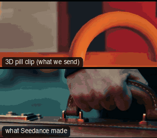

# SHOW01-TheHandoff: The Handoff



Family: Showcase film.

**What it says.** A whole 30 second scene built from the template moves: ten shots, two people, a case, a drone and a chase, planned as pills and drawn as a storyboard before anything real was made.

**Use it for.** Seeing the whole method at once: the pill previs holds every cut to the frame, and the finished film follows it shot for shot.

**Camera numbers.** 10 shots, 24 fps, 2.39:1, every shot held 2 seconds or more. Golden hour, one 180 degree line, the clock slows to 1/25 for the leap and snaps back.

**Avoid.** Cuts shorter than 2 seconds, and a crash zoom with no hold after it.

## The three.js code

This is an excerpt of the template (364 lines, from `engine/cinematic/src/templates/showcase.ts`). `template.ts` in this folder is the same code with its imports. The helpers it calls (`make`, the actors, the rigs, the set and the post chain) are in `engine/cinematic/src`, so it does not run on its own: render it with `tools/render-pill.sh`.

```ts
// SHOW01-TheHandoff
// Copied from engine/cinematic/src/templates/showcase.ts (all of that file).
// The set builders, rigs and stand-ins it calls live in engine/cinematic/src and kit/.
// Render it: cd engine/cinematic && tools/render-pill.sh SHOW01-TheHandoff
// SHOW01 The Handoff: a 30 s showcase that strings twelve of the template moves into one scene. Alex waits in the
// plaza with a suitcase; Mara comes without the money; a drone rises behind her; he runs, climbs a block, leaps, and in
// bullet time the case bursts open, empty. He lands and looks back at her.
// Layout (metres, -z north): Alex waits at (0, -4) facing south, Mara stops at (0.25, -1.6) facing him; every dialogue
// camera stays east of the line between them. The sun is low in the south-south-west, behind Mara, so she is rim-lit.
// Two buildings stand south-south-west beyond the open side of the plaza: the drone rises behind them, behind Mara.
// Alex flees north through the gap between the two northernmost columns, runs west outside the colonnade, climbs the
// block at about (-13, -17), leaps off its far edge, rolls, and stops where his look back passes a column gap to Mara.
// Everything in the set runs on the world clock (a speed ramp freezes the leap); cameras run on film time.
// Ten shots: slider, crane, OTS, her single, crash zoom, her single with the drone, FPV, bullet time, the case insert, the landing arc.
import * as THREE from "three";
import { scenePiece, planner, speedRamp, type KitWorld, type SceneSpec, type ShotDef } from "../kit/stage";
import type { Act, Actor, ActorSpec, PathKey } from "../kit/actors";
import { around, framed, lag, rig } from "../kit/rigs";
import { aimFor, frameHeight, SENSOR_H } from "../framer";
import { GREY, clay } from "../kit/clay";
import { barrel, bench, broadTree, building, column, crate, ground, lampPost, pine, rock, scatter, steps } from "../kit/props";
import { clamp, lerp, ramp, smooth, smoother } from "../util";
import type { Piece } from "../piece";
import type { Cam, Shot } from "../shots";
import { body, clip, gaitClock, jogRow, JOG_MEAN, local, STAND } from "./action";

const V = (x: number, y: number, z: number) => new THREE.Vector3(x, y, z);
const UP = V(0, 1, 0);
const flat = (v: THREE.Vector3) => v.clone().setY(0);
/** linear progress 0..1 (ramp() is already eased: wrapping it in another ease bunches a move into a few frames) */
const lin = (t: number, a: number, b: number) => clamp((t - a) / (b - a));
/** progress at a constant rate, eased only over the first and last `e` seconds */
const easeEnds = (t: number, a: number, b: number, e: number) => { const T = b - a, x = clamp(t - a, 0, T), L = T - e; const f = x < e ? (x * x) / (2 * e) : x <= T - e ? x - e / 2 : L - ((T - x) * (T - x)) / (2 * e); return f / L; };

// ---- the clock: real time until the leap, eased to 1/25 at its top, held while the camera circles, eased back ----
export const CLOCK = speedRamp([[0, 1], [21.1, 1], [21.4, 0.04], [26.0, 0.04], [26.25, 1], [40, 1]]);
/** film time at world time w (the clock is monotonic) */
const filmAt = (w: number) => { let a = 0, b = 40; for (let i = 0; i < 50; i++) { const m = (a + b) / 2; if (CLOCK(m) < w) a = m; else b = m; } return (a + b) / 2; };

// ---- marks ----
const A0 = V(0, 0, -4), M1 = V(0.25, 0, -1.6);
const YAW_A = Math.atan2(M1.x - A0.x, M1.z - A0.z) + 0.3, YAW_M = Math.atan2(A0.x - M1.x, A0.z - M1.z);
const RUN_Z = -16.3;

// ---- Alex's run (world time): spins on "Run.", bolts at 16.6 straight for the gap, west along z -16.3 past the block, leaps, rolls, stops ----
const T_RUN = 16.6, TE = 21.0, TC = TE - 1.02, VY = 3.2, VH = 4.2;                 // take-off on the cut to the orbit
const FLIGHT = (VY + Math.sqrt(VY * VY + 2 * 9.81 * 1.0)) / 9.81, TL = TE + FLIGHT, T_STOP = TL + 2.5;
// a straight line to the gap, a straight west leg for the block, then a bend north so the look back passes between columns 6 and 7
const RUN = new THREE.CatmullRomCurve3([V(0, 0, -4), V(-0.62, 0, -6.5), V(-1.24, 0, -9.05), V(-2.49, 0, -14.1), V(-4.0, 0, RUN_Z), V(-7, 0, RUN_Z), V(-10, 0, RUN_Z), V(-13, 0, RUN_Z),
  V(-15, 0, RUN_Z + 0.7), V(-16.2, 0, RUN_Z + 2.3), V(-16.6, 0, RUN_Z + 4.8)], false, "centripetal");
const RUN_L = RUN.getLength();
const SPEEDS: [number, number][] = [[T_RUN, 0], [T_RUN + 1.0, 5.0], [TC - 0.1, 5], [TC + 0.1, 2.9], [TC + 0.6, 3.6], [TC + 0.75, 4.4], [TE - 0.05, VH], [TL, VH],
  [TL + 0.15, 3.6], [TL + 0.9, 3.5], [TL + 1.7, 1.6], [T_STOP, 0], [60, 0]];
const vAt = (t: number) => { if (t <= SPEEDS[0][0]) return 0; for (let i = 1; i < SPEEDS.length; i++) if (t <= SPEEDS[i][0]) return lerp(SPEEDS[i - 1][1], SPEEDS[i][1], (t - SPEEDS[i - 1][0]) / (SPEEDS[i][0] - SPEEDS[i - 1][0])); return 0; };
const S_DT = 1 / 240, S_TAB: number[] = [0];
for (let t = T_RUN; t < 40; t += S_DT) S_TAB.push(S_TAB[S_TAB.length - 1] + vAt(t + S_DT / 2) * S_DT);
const sAt = (t: number) => { if (t <= T_RUN) return 0; const x = (t - T_RUN) / S_DT, i = Math.min(Math.floor(x), S_TAB.length - 2); return lerp(S_TAB[i], S_TAB[i + 1], x - i); };
const yAt = (t: number) => (t > TC && t < TL + 0.05 ? (t < TE ? ramp(t, TC + 0.05, TC + 0.45) : Math.max(0, 1 + VY * (t - TE) - 4.9 * (t - TE) ** 2)) : 0);
/** Alex's ground point at world time t */
export const alexAt = (t: number) => { const p = RUN.getPointAt(clamp(sAt(t) / RUN_L)); p.y = yAt(t); return p; };
// ... (see template.ts for the rest)
```

## The videos

The stand-in in `pill.mp4` is the **capsule** (the single striped capsule of the first gallery clips). Render the other with `--standin pin`.

| What | File |
|---|---|
| The 3D pill clip, the reference video | `pill.mp4` |
| The contact sheet (sketch route) | `sketch-sheet.jpg` |
| What Seedance made from the pill clip (480p draft) | `release-media/SHOW01-TheHandoff/result.mp4` (release asset) |
| What Seedance made from the contact sheet | `release-media/SHOW01-TheHandoff/sketch-output.mp4` (release asset) |
| Another take from the same template | `release-media/SHOW01-TheHandoff/sketch-v2-sheet.mp4` |
| Another take from the same template | `release-media/SHOW01-TheHandoff/sketch-v3-sheet.mp4` |
| Another take from the same template | `release-media/SHOW01-TheHandoff/sketch-v4-sheet.mp4` |
| Another take from the same template | `release-media/SHOW01-TheHandoff/sketch-v5-sheet.mp4` |
| Another take from the same template | `release-media/SHOW01-TheHandoff/sketch-v6-sheet.mp4` |
| Another take from the same template | `release-media/SHOW01-TheHandoff/video-v1.mp4` |
| Another take from the same template | `release-media/SHOW01-TheHandoff/video-v2-video.mp4` |
| Another take from the same template | `release-media/SHOW01-TheHandoff/video-v3.mp4` |

## The prompt

One file per send. `sent.json` says, for each, whether it is the text that was sent, a recovered copy, or a rebuilt copy (`prompt.provenance`):

- `prompts/sketch-v2-sheet.txt`
- `prompts/sketch-v3-sheet.txt`
- `prompts/sketch-v4-sheet.txt`
- `prompts/sketch-v5-sheet.txt`
- `prompts/sketch-v6-sheet.txt`
- `prompts/video-v1.txt`
- `prompts/video-v2-video.txt`
- `prompts/video-v3.txt`

Keep the lines that say what the pills are and that the set is to be rebuilt as real. Change the person, the place and the light. These prompts come from the gallery runs and many predate the checks in `tools/seedance/`, so rebuild one with the gates before you reuse it.

## How it was sent

`sent.json` holds, for each send: the references in order with their roles, the settings, the credits and the outcome. Request ids are not kept; where one was known, a short hash is stored.

- **video #1**: 29 s, draft (480p preview), 21:9; references: @video1 = pill clip (the 30 s blockout, 29 s trimmed), @image1 = person photo (face reference), @audio1 = approved voice clip; confirmed: yes; 4228.2 credits.
- **video #2**: 29 s, draft (480p preview), 21:9; references: @video1 = pill clip (the 30 s blockout, 29 s trimmed), @image1 = person photo (face reference), @audio1 = approved voice clip; confirmed: yes; 4228.2 credits.
- **video #3**: 29 s, draft (480p preview), 21:9; references: @video1 = pill clip (the 30 s blockout, 29 s trimmed), @image1 = person photo (face reference), @audio1 = approved voice clip; confirmed: yes; 4228.2 credits.
- **sketch #1**: 29 s, draft (480p preview), 21:9; references: @image1 = person photo (face reference), @image2 = pill contact sheet (30 panels), @audio1 = approved voice clip; confirmed: yes; 3543.8 credits.
- **sketch #2**: 29 s, draft (480p preview), 21:9; references: @image1 = person photo (face reference), @image2 = pill contact sheet (30 panels), @audio1 = approved voice clip; confirmed: yes; 3543.8 credits.
- **sketch #3**: 29 s, draft (480p preview), 21:9; references: @image1 = person photo (face reference), @image2 = pill contact sheet (30 panels), @audio1 = approved voice clip; confirmed: yes; 3543.8 credits.
- **sketch #4**: 29 s, draft (480p preview), 21:9; references: @image1 = person photo (face reference), @image2 = pill contact sheet (30 panels), @audio1 = approved voice clip; confirmed: yes; 3543.8 credits.
- **sketch #5**: 29 s, draft (480p preview), 21:9; references: @image1 = person photo (face reference), @image2 = pill contact sheet (30 panels), @audio1 = approved voice clip; confirmed: yes; 3543.8 credits.

See `reproduce.md` to render it and send it yourself.
