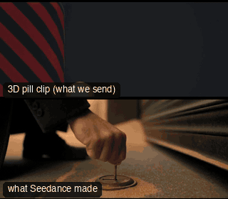

# STORY03-TheGap: Dive to the shutter



**What it says.** From the sky onto a man who can barely walk, across a dead place, to one spot where he turns a key.

**Use it for.** A silent 30 s scene with a want, an obstacle and a release.

**Camera numbers.** 7 shots, 30 s: CAM42 drone dive, 50 mm lead, 25 mm boots, CAM25 arc and rise, 28 mm follow, 35 mm face, 50 mm key.

**Avoid.** Rushing the kneel or the silence after the bolt.

## The three.js code

This is an excerpt of the template (145 lines, from `engine/cinematic/src/templates/story.ts`). `template.ts` in this folder is the same code with its imports. The helpers it calls (`make`, the actors, the rigs, the set and the post chain) are in `engine/cinematic/src`, so it does not run on its own: render it with `tools/render-pill.sh`.

```ts
// STORY03-TheGap
// Copied from engine/cinematic/src/templates/story.ts (all of that file).
// The set builders, rigs and stand-ins it calls live in engine/cinematic/src and kit/.
// Render it: cd engine/cinematic && tools/render-pill.sh STORY03-TheGap
// STORY02: one 30 s scene on the orange-dust plaza set, built from two favourite blockouts: CAM42 (the drone dive) OPENS it and CAM25 (arc and rise) is
// its middle beat, with new shots between them (7 Nov 2026; shot list from an independent director).
// A man with a bad left leg and no crutch walks toward the camera across the plaza against the wind, stumbles, stops with a hand on his knee while the camera
// arcs and rises round him (CAM25: he is small in the world), goes on to a half-buried roll-down shop shutter in a monumental wall, kneels at its floor-level lock
// and turns the brass key. Nothing is rushed: his walk tops out at 0.8 m/s, every move eases in and out. The pin carries place, size and heading; every pose and
// expression comes from the prompt; the colonnades and the tower come from the prompt too, as in the CAM25 take.
import * as THREE from "three";
import { ramp, smoother } from "../util";
import { rig } from "../kit/rigs";
import type { Cam } from "../shots";
import { aimFor } from "../framer";
import { ALEX, SAM, V, make as baseMake } from "./cameras";
import { ENVIRONMENTS } from "./locations";
import type { Piece } from "../piece";

const plaza = ENVIRONMENTS["17-orange-dust"] as unknown as { sky: string; keyDir?: [number, number, number]; build: (w: { add: (o: THREE.Object3D) => void }) => void };
type W = { add: (o: THREE.Object3D) => void };
const mat = (hex: string) => new THREE.MeshStandardMaterial({ color: hex, roughness: 0.92 });
const block = (w: number, h: number, d: number, x: number, y: number, z: number, hex: string) => { const m = new THREE.Mesh(new THREE.BoxGeometry(w, h, d), mat(hex)); m.position.set(x, y, z); m.castShadow = m.receiveShadow = true; return m; };
const dome = (r: number, x: number, y: number, z: number, hex: string) => { const m = new THREE.Mesh(new THREE.SphereGeometry(r, 40, 20, 0, Math.PI * 2, 0, Math.PI / 2), mat(hex)); m.position.set(x, y, z); m.castShadow = m.receiveShadow = true; return m; };

/** he walks +z along x = 0; the monumental wall (face at z = WALL_Z) holds the shutter, the lock at its foot; he kneels at KNEEL_Z facing it */
const WALL_Z = 7.8, KNEEL_Z = 6.9, LOCK_Z = WALL_Z - 0.35;
const set = {
  sky: plaza.sky, keyDir: plaza.keyDir,
  build: (w: W) => {
    plaza.build(w);
    w.add(block(40, 14, 1.0, 0, 7, WALL_Z + 0.5, "#9a8f84"));                                                         // the wall, face at z = 7.8
    for (let i = 0; i < 8; i++) w.add(block(4.0, 0.2, 0.14, 0, -0.2 + i * 0.2, WALL_Z - 0.07, i % 2 ? "#4a4540" : "#5b5651"));   // the shutter, half buried
    { const brass = new THREE.MeshStandardMaterial({ color: "#c9992f", roughness: 0.5, metalness: 0.35 });          // the brass floor lock: a round plate set flat in the ground in front of the shutter, keyhole on top
      const plate = new THREE.Mesh(new THREE.CylinderGeometry(0.075, 0.075, 0.03, 28), brass); plate.position.set(0, 0.015, LOCK_Z); w.add(plate);
      const hole = new THREE.Mesh(new THREE.BoxGeometry(0.03, 0.006, 0.012), mat("#1a1714")); hole.position.set(0, 0.032, LOCK_Z); w.add(hole); }
    w.add(block(44, 270, 44, 0, 135, 70, "#8a8076"));                                                                   // the tower behind the wall, on the axis
    for (const [x, z, r] of [[-70, 110, 34], [90, 100, 30], [150, 40, 40], [-130, 30, 30]] as [number, number, number][]) { w.add(block(r * 2.1, r * 0.7, r * 2.1, x, r * 0.35, z, "#8a7f74")); w.add(dome(r, x, r * 0.7, z, "#9a8f84")); }
    for (const [x, z] of [[-14, 40], [14, 40], [-26, 62], [26, 62]] as [number, number][]) w.add(block(3.4, 70, 3.4, x, 35, z, "#8f847a"));
  },
};

type K = { t: number; at: [number, number]; yaw?: number };
// slow and labored, 0.8 m/s at most: toward us across the plaza (the dive ends with him at the origin at 6.4 s), a stumble at 10.8 s, a stop with a hand on the knee
// from 11.8 s to 19 s while CAM25 circles him, then on to the shutter, kneeling at 24 s facing it (+z)
const WALK: K[] = [
  { t: 0.4, at: [0, -3.4], yaw: 0.2 }, { t: 6.4, at: [0, 0], yaw: 0.2 }, { t: 10.4, at: [0, 3.0] },
  { t: 11.8, at: [0, 3.7] }, { t: 17.4, at: [0, 3.75] }, { t: 18.6, at: [0, 3.9] }, { t: 20.2, at: [0, 4.65] }, { t: 21.8, at: [0, 5.85] }, { t: 23.2, at: [0, KNEEL_Z], yaw: 0 },
];

type FocusFn = (t: number) => { pos: THREE.Vector3; name: string };
let FOCUS: FocusFn[] = [];   // filled in by the shots function below, applied to the built shots afterwards
const STOPS = [8, 2.0, 2.0, 2.8, 4.0, 2.0, 2.0];   // the aperture of each shot: deep for the dive, shallow for the faces and the lock

const zAt = (t: number) => { for (let i = 1; i < WALK.length; i++) if (t <= WALK[i].t) { const a = WALK[i - 1], b = WALK[i], k = (t - a.t) / (b.t - a.t); return a.at[1] + (b.at[1] - a.at[1]) * k; } return WALK[WALK.length - 1].at[1]; };
// his steps: a footprint for the good right foot (x -0.1), a drag scrape for the bad left foot (x +0.1), one per 0.6 s while he walks; none while he stops (11.8 to 18.8 s)
const STEPS: { t: number; bad: boolean }[] = [];
{ let bad = false; for (let t = 7.0; t <= 11.8; t += bad ? 0.5 : 0.7) { STEPS.push({ t, bad }); bad = !bad; } bad = false; for (let t = 19.2; t <= 23.0; t += bad ? 0.5 : 0.7) { STEPS.push({ t, bad }); bad = !bad; } }
const stepActors = STEPS.map((st, i) => { const x = st.bad ? 0.1 : -0.1, z = zAt(st.t) + (st.bad ? -0.05 : 0.1); return { id: `STEP${i}`, name: `Step ${i}`, kind: "prop", model: st.bad ? "scrape" : "print", tint: "sand", path: [{ t: 0, at: [x, -1, z] }, { t: st.t - 0.05, at: [x, -1, z] }, { t: st.t, at: [x, 0.006, z] }] } as never; });

// ... (see template.ts for the rest)
```

## The videos

The stand-in in `pill.mp4` is the **pin** (a head on a slim body). Render the other with `--standin capsule`.

| What | File |
|---|---|
| The 3D pill clip, the reference video | `pill.mp4` |
| Another take from the same template | `release-media/STORY03-TheGap/story03-ext-4k.mp4` |
| Another take from the same template | `release-media/STORY03-TheGap/story03-ext-final.mp4` |
| Another take from the same template | `release-media/STORY03-TheGap/story03-ext.mp4` |

## The prompt

One file per send. `sent.json` says, for each, whether it is the text that was sent, a recovered copy, or a rebuilt copy (`prompt.provenance`):

- `prompts/story03-ext-4k.txt`
- `prompts/story03-ext.txt`

Keep the lines that say what the pills are and that the set is to be rebuilt as real. Change the person, the place and the light. These prompts come from the gallery runs and many predate the checks in `tools/seedance/`, so rebuild one with the gates before you reuse it.

## How it was sent

`sent.json` holds, for each send: the references in order with their roles, the settings, the credits and the outcome. Request ids are not kept; where one was known, a short hash is stored.

- **video #1**: 30 s, draft (480p preview), adaptive; references: @video1 = continuation source: the last 12 s of the chosen plaza take, sound removed, @image1 = Alex's face photo: identity only (features, hair, beard), @audio1 = the author's voice recording (not included): timbre, pace and accent for Alex's spoken line; confirmed: yes; 3645 credits.
- **video #2**: 30 s, 4k, adaptive; references: @video1 = continuation source: the last 12 s of the chosen plaza take, sound removed, @image1 = Alex's face photo: identity only (features, hair, beard), @audio1 = the author's voice recording (not included): timbre, pace and accent for Alex's spoken line; confirmed: yes; 33650 credits.

See `reproduce.md` to render it and send it yourself.
